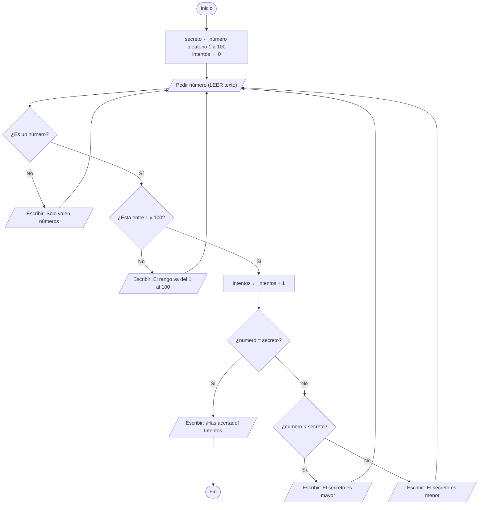

# Diseño del juego «adivina el número»

Autoría: *Irene Lago González*

<!--
Instrucciones: se sustituye cada línea «_Pendiente._» por el contenido del apartado.
Los comentarios como este no se ven en GitHub y pueden borrarse al terminar.
No se cambian los títulos numerados: las comprobaciones automáticas los buscan.
-->

## 1. Análisis del entorno

Este juego lo usaría alguien que está aprendiendo a programar, por ejemplo
la gente de clase, para practicar. Se jugaría en la consola (la pantalla
negra con texto), sin dibujos ni ratón.

Eso significa que:
- Todo se hace escribiendo: el programa escribe mensajes y la persona
  teclea sus números.
- Lo que escribe la persona entra como texto, así que habrá que comprobar
  que de verdad es un número y no otra cosa (una letra, por ejemplo).
- Juega una sola persona y una partida cada vez.

## 2. Análisis del problema

- **Entrada:** el número que escribe la persona en cada intento.
- **Proceso:** el programa piensa un número secreto entre 1 y 100. Cada vez
  que la persona prueba un número, lo compara con el secreto y se apunta
  cuántos intentos lleva. Esto se repite hasta que acierta.
- **Salida:** en cada intento dice si el número secreto es mayor o menor
  que el que se ha probado. Cuando se acierta, dice que has ganado y
  cuántos intentos han hecho falta.

## 3. Estrategia

**Nivel 1 (pasos grandes)**
1. Preparar el juego
2. Jugar (repetir intentos hasta acertar)
3. Terminar

**Nivel 2 (cada paso dividido en otros más pequeños)**
1. Preparar el juego
   - 1.1. Elegir el número secreto entre 1 y 100
   - 1.2. Poner el contador de intentos a 0
2. Jugar
   - 2.1. Pedir un número a la persona
   - 2.2. Comprobar que es un número válido (si no, avisar y volver a pedirlo)
   - 2.3. Sumar 1 al contador de intentos
   - 2.4. Comparar el número con el secreto y dar la pista
3. Terminar
   - 3.1. Decir que ha acertado
   - 3.2. Mostrar cuántos intentos ha necesitado

## 4. Dificultades y casos de prueba

**Dificultades**
- **Entradas no válidas:** si escriben "hola" u otra cosa que no sea un
  número, el programa dice que solo valen números y vuelve a pedirlo,
  sin contar el intento.
- **Valores fuera de rango:** si escriben 107, el programa dice que el
  rango va del 1 al 100 y vuelve a pedirlo, sin contar el intento.
- **Terminación del bucle:** el bucle de intentos se repite hasta que el
  número coincide con el secreto. Solo entonces se sale y se muestran los
  intentos.

**Casos de prueba** (con número secreto 42)

| Entrada | Qué debe pasar | ¿Cuenta intento? |
|---|---|---|
| 50 | Dice que el secreto es menor | Sí |
| 30 | Dice que el secreto es mayor | Sí |
| 42 | Acierta y termina | Sí |
| hola | Dice que solo valen números | No |
| 0 | Dice que el rango va del 1 al 100 | No |
| 101 | Dice que el rango va del 1 al 100 | No |
| 1 y 100 | Se aceptan (son los límites) | Sí |

## 5. Pseudocódigo

INICIO
    secreto ← número aleatorio entre 1 y 100
    intentos ← 0
    acertado ← FALSO

    MIENTRAS acertado = FALSO
        ESCRIBIR "Escribe un número del 1 al 100"
        LEER texto

        SI texto no es un número ENTONCES
            ESCRIBIR "Solo valen números"
        SINO
            numero ← texto convertido a número
            SI numero < 1 O numero > 100 ENTONCES
                ESCRIBIR "El rango va del 1 al 100"
            SINO
                intentos ← intentos + 1
                SI numero < secreto ENTONCES
                    ESCRIBIR "El número secreto es mayor"
                SINO SI numero > secreto ENTONCES
                    ESCRIBIR "El número secreto es menor"
                SINO
                    acertado ← VERDADERO
                FIN SI
            FIN SI
        FIN SI
    FIN MIENTRAS

    ESCRIBIR "¡Has acertado! Intentos: ", intentos
FIN

## 6. Diagrama de flujo

## 7. Prueba de escritorio

Número secreto: **42**. Los intentos cubren todos los caminos del diagrama.

| Paso | Escribe | Camino del diagrama | Mensaje | intentos |
|---|---|---|---|---|
| 0 | (inicio) | Preparar el juego | — | 0 |
| 1 | hola | ¿Es un número? → No | Solo valen números | 0 |
| 2 | 500 | ¿Entre 1 y 100? → No | El rango va del 1 al 100 | 0 |
| 3 | 30 | Sí, sí, no igual, 30 < 42 | El secreto es mayor | 1 |
| 4 | 50 | Sí, sí, no igual, 50 > 42 | El secreto es menor | 2 |
| 5 | 42 | Sí, sí, igual | ¡Has acertado! Intentos: 3 | 3 |

## 8. Alternativa y selección

**Qué se compara:** cómo contar los intentos.

- **Opción A (elegida):** solo cuentan los intentos válidos (un número
  entre 1 y 100). Si escriben "hola" o 500, avisa y no suma.
- **Opción B:** cuenta todo lo que se escriba, aunque no sea válido.

Valoración (1 = peor, 3 = mejor):

| Criterio | Opción A | Opción B |
|---|---|---|
| Es justa para quien juega | 3 | 1 |
| Es fácil de entender | 3 | 3 |
| Es fácil de hacer en el diagrama | 2 | 3 |
| El resultado final es fiable | 3 | 2 |
| **Total** | **11** | **9** |

**Elección:** la opción A, porque no castiga a la persona por un despiste
al teclear. La opción B es un poco más simple de dibujar, pero el número
de intentos final no refleja los intentos reales.

_Pendiente._

## 9. Verificación en Python

<!-- Tabla: Símbolo o paso | Construcción en Python | Detalle a tener en cuenta (apartado 8). -->

_Pendiente._
